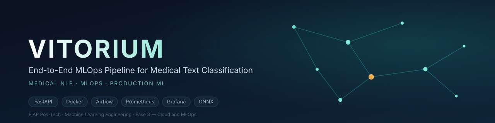
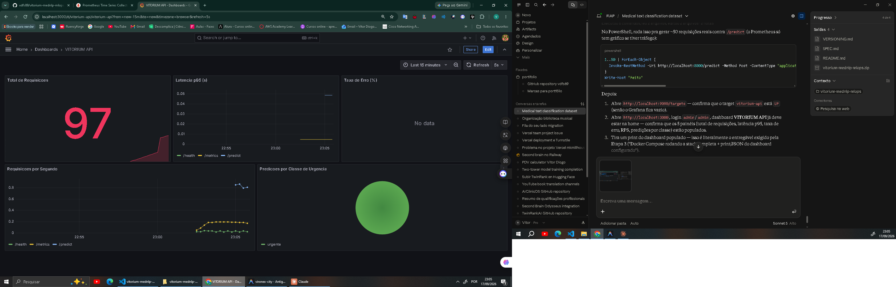
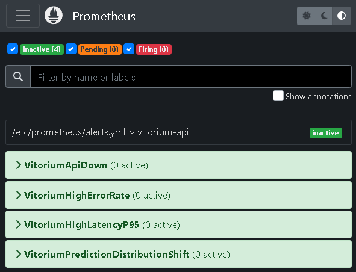
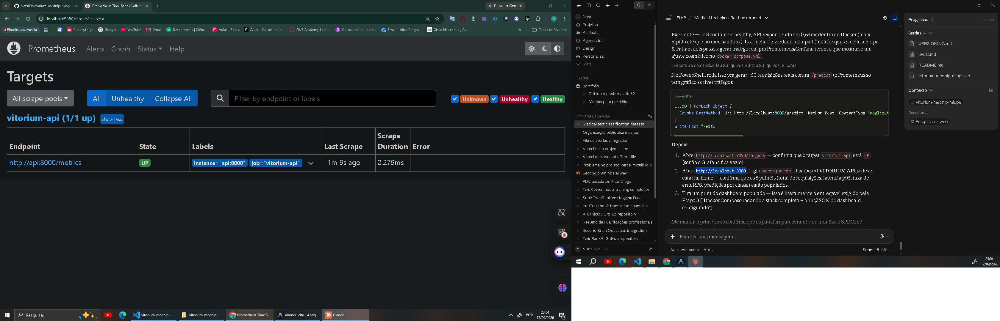

<p align="center">
  
</p>

# VITORIUM

**End-to-End MLOps Pipeline for Medical Text Classification**
Medical NLP · MLOps · Production ML

Tech Challenge — FIAP Pós-Tech em Machine Learning Engineering, Fase 3 (Cloud and MLOps).

| Documento | Conteúdo |
|---|---|
| [`docs/SPEC.md`](docs/SPEC.md) | Especificação (SDD): rastreabilidade de cada requisito obrigatório + ADRs |
| [`docs/MODEL_CARD.md`](docs/MODEL_CARD.md) | Model Card: métricas por classe, limitações, vieses e cenários de falha |
| [`docs/MONITORING.md`](docs/MONITORING.md) | Plano de monitoramento: SLOs, alertas e playbook de resposta |
| [Vídeo STAR](#vídeo-star) | Apresentação de 5 minutos (método STAR) |
| [`docs/VERSIONING.md`](docs/VERSIONING.md) | Regra de versionamento (tags SemVer) |
| [`docs/evidence/`](docs/evidence/) | Evidências de execução: Prometheus, Grafana e Airflow |

## Contexto

Um hospital de referência precisa de um sistema de triagem automática de laudos
médicos para classificar urgência. O VITORIUM é um classificador de texto (NLP)
leve, servido via API REST em container Docker, com pipeline de retreino
orquestrado (Airflow), monitoramento (Prometheus + Grafana) e otimização de
latência (ONNX Runtime).

## Dataset e mapeamento de rótulos — nota de honestidade

Usamos o [Medical Abstracts TC Corpus](https://github.com/sebischair/Medical-Abstracts-TC-Corpus)
(sebischair, NLPIR 2022): 14.438 abstracts médicos rotulados em 5 categorias de
condição de paciente.

| Classe original | Treino | Teste | Total |
|---|---:|---:|---:|
| 1. Neoplasms | 2.530 | 633 | 3.163 |
| 2. Digestive system diseases | 1.195 | 299 | 1.494 |
| 3. Nervous system diseases | 1.540 | 385 | 1.925 |
| 4. Cardiovascular diseases | 2.441 | 610 | 3.051 |
| 5. General pathological conditions | 3.844 | 961 | 4.805 |

O corpus não traz rótulos de urgência clínica. Aplicamos um **mapeamento
heurístico** (`src/training/preprocess.py`) para a narrativa de triagem do
desafio:

| Urgência | Classes originais | Amostras | % |
|---|---|---:|---:|
| `urgente` | Cardiovascular + Nervous system | 4.976 | 34,5% |
| `atencao` | Neoplasms + Digestive system | 4.657 | 32,3% |
| `normal` | General pathological conditions | 4.805 | 33,3% |

> **Os rótulos de urgência (normal/atenção/urgente) são um mapeamento
> heurístico das 5 categorias originais do dataset, criado para fins
> didáticos de MLOps. Não refletem triagem clínica real (ex.: Manchester,
> ESI) e não devem ser usados para decisões médicas.**

**Atribuição:** dataset licenciado sob CC BY-SA 3.0. Autoria original:
Schopf, T., Braun, D., Matthes, F., "Evaluating Unsupervised Text
Classification: Zero-shot and Similarity-based Approaches", NLPIR 2022.
Os CSVs em `data/raw/` são redistribuídos aqui sob os mesmos termos.

Efeito colateral: o reagrupamento resultou em 3 classes quase perfeitamente
balanceadas (~33/33/33%), eliminando o desbalanceamento 3,2x do dataset
original sem qualquer balanceamento artificial.

## Decisão arquitetural: híbrido batch + tempo real

Seguindo o princípio de que **arquiteturas de ML são pipelines, não
endpoints isolados**, o sistema combina dois modos de deploy:

- **Batch** (Airflow DAG, `dags/train_pipeline_dag.py`): ingestão do dataset
  completo → treino → salvamento do modelo. Roda offline, agendado.
- **Tempo real** (FastAPI, `src/api/main.py`): inferência síncrona por laudo
  individual, stateless, resposta em milissegundos.

Diferente de sistemas com busca vetorial (RAG, recomendação), não há aqui um
componente de reindexação — a atualização contínua se resume ao retreino
agendado via `schedule="@weekly"` na DAG.

**Nuvem (documentação teórica, Etapa 1):** entre AWS (SageMaker/Lambda/ECS),
GCP (Vertex AI/Cloud Run) e Azure (ML Studio/AKS), a recomendação é
**Google Cloud Run**: aceita o container Docker diretamente, escala a zero
(FinOps — sem custo parado), cold start baixo porque o artefato é leve
(TF-IDF + LogisticRegression, sem GPU), e não exige a complexidade de
rede/IAM de um cluster (ECS/AKS) para uma API única e stateless. Validação
rápida contra o framework de decisão da aula:

| Pergunta | Resposta |
|---|---|
| Custo por inferência | Baixo — CPU-only, milissegundos |
| Precisa do dataset completo? | Não — só o artefato treinado |
| Responde por evento? | Sim — `/predict` é stateless |
| Sempre carregado? | Não precisa — modelo leve, cold start rápido |
| CPU ou GPU? | CPU só |

A ponte para a nuvem já existe: a cada push na `main`, o CI publica a
imagem no GitHub Container Registry (`ghcr.io/vdfs89/vitorium-mednlp-mlops`,
tags `latest` e `<sha do commit>`), o artefato que um `gcloud run deploy
--image` consumiria. O deploy real em nuvem é opcional/bônus e **não** foi
feito; o obrigatório (stack local via Docker Compose) está descrito abaixo.

## Resultados reais (medidos, não estimados)

Cada número abaixo vem de um arquivo versionado em `models/`, gerado por um
script do repositório. Nenhum é estimativa.

**Modelo** (`src/training/train.py`, TF-IDF + LogisticRegression, seed 42 —
fonte: `models/metrics.json`). Treino determinístico: o re-treino do zero
na DAG do Airflow reproduziu acurácia e macro F1 idênticos aos versionados
(`docs/evidence/airflow_dags_test.log`).

| Métrica | Valor |
|---|---:|
| Acurácia (holdout de teste, 2.888 amostras) | 0,6195 |
| Macro F1 | 0,6158 |
| F1 por classe (`atencao` / `urgente` / `normal`) | 0,715 / 0,669 / 0,463 |
| Tempo de treino | 3,79 s |

A classe `normal` ("general pathological conditions") é a mais fraca por ser
uma categoria genérica que se sobrepõe às outras — detalhes no
[Model Card](docs/MODEL_CARD.md).

**Otimização de latência — ONNX Runtime (Etapa 4).** A API serve o modelo
ONNX por padrão (`VITORIUM_BACKEND=onnx`, com fallback para sklearn) e o
`/health` informa qual backend está ativo.

| Medição | sklearn | ONNX | Ganho | Fonte |
|---|---:|---:|---:|---|
| Inferência pura, média por texto (sem HTTP) | 1,084 ms | 0,265 ms | **4,09x** | `models/onnx_latency_comparison.json` |
| API `/predict` end-to-end, p50 | 3,401 ms | 2,514 ms | **1,35x** | `models/api_latency_comparison.json` |
| API `/predict` end-to-end, p95 | 4,486 ms | 3,115 ms | 1,44x | `models/api_latency_comparison.json` |
| API `/predict` end-to-end, p99 | 8,109 ms | 5,188 ms | 1,56x | `models/api_latency_comparison.json` |

Metodologia end-to-end (`scripts/compare_backends.py`): dois servidores
uvicorn idênticos, diferentes só no backend, 5 rodadas intercaladas × 300
requisições (warmup de 50), mediana entre rodadas; o ONNX teve p50 menor nas
5 rodadas. Equivalência: em todos os 2.888 textos de teste, o ONNX dá o
mesmo rótulo que o sklearn (diferença máxima de probabilidade 1,6e-7); a
exportação **falha** se a paridade quebrar. Leitura honesta: o modelo fica
~4x mais rápido, mas na API o ganho é 1,35x porque HTTP, FastAPI e Pydantic
dominam o tempo de resposta.

> **Errata.** Até a `v0.1.1` este README publicava 7,70x de speedup. Esse
> número vinha de uma exportação ONNX padrão do skl2onnx que **não era
> equivalente** ao modelo (descartava as stop words; ~1,2% dos rótulos
> divergiam — 35 de 2.888, ver `docs/evidence/onnx_stock_export_parity.json`)
> e que nem carregava na imagem `python:3.11-slim` (dependia do locale
> `en_US.UTF-8`). O exportador foi reescrito
> (`src/training/onnx_export.py`) e todos os números acima foram medidos de
> novo.

**Retreino orquestrado (Etapa 2).** A DAG `vitorium_train_pipeline`
(`ingest_data → train_model → export_onnx → save_model_report`) foi
executada de verdade com Apache Airflow 2.10.5 (`airflow dags test`):
4/4 tasks `success`, métricas idênticas às versionadas e paridade ONNX de
100%. Log em [`docs/evidence/airflow_dags_test.log`](docs/evidence/airflow_dags_test.log).

## Monitoramento e alertas

O `/metrics` expõe contagem de requisições por endpoint/status, histograma
de latência e contagem de predições por classe. O Grafana sobe com um
dashboard de 5 painéis provisionado; o Prometheus avalia 4 regras de alerta
(`docker/alerts.yml`), cobertas por testes unitários do `promtool`
(`docker/alerts_test.yml`; saída em `docs/evidence/promtool_hadolint.txt`):

| Alerta | Dispara quando | Severidade |
|---|---|---|
| `VitoriumApiDown` | target da API fora do ar por 1 min | critical |
| `VitoriumHighErrorRate` | > 5% de respostas 5xx em 5 min | critical |
| `VitoriumHighLatencyP95` | p95 do `/predict` > 50 ms por 10 min | warning |
| `VitoriumPredictionDistributionShift` | fração de alguma classe em 1 h desvia > 15 p.p. da distribuição de treino (proxy de drift) | warning |

SLOs, diagnóstico e resposta para cada alerta estão no
[playbook](docs/MONITORING.md). Não há Alertmanager configurado: os alertas
aparecem em `http://localhost:9090/alerts`.

**Dashboard "VITORIUM API" com tráfego real** (178 requisições ao `/predict`
com textos variados: 60 `urgente`, 60 `atencao`, 58 `normal`, 0 erros):



**As 4 regras de alerta carregadas no Prometheus da stack** (inativas, sem
incidente) e o target da API no ar:

<p>
  
  
</p>

## Estrutura do repositório

```
vitorium-mednlp-mlops/
├── .github/workflows/ci.yml   # lint -> test (treina + exporta ONNX) -> build + push GHCR
├── dags/train_pipeline_dag.py # Airflow: ingest -> train -> export_onnx -> report
├── data/{raw,processed}/      # CSVs (gitignored; baixados pelo CI / localmente)
├── docker/
│   ├── docker-compose.yml     # api + prometheus + grafana
│   ├── prometheus.yml         # scrape + rule_files
│   ├── alerts.yml             # 4 alertas + recording rules
│   ├── alerts_test.yml        # testes unitarios das regras (promtool)
│   └── grafana/provisioning/  # datasource + dashboard (5 paineis)
├── docs/                      # SPEC, Model Card, monitoramento, evidencias
├── models/                    # model.joblib, model.onnx, metrics.json, benchmarks (JSON)
├── scripts/
│   ├── bench_latency.py       # latencia contra um servidor rodando
│   ├── compare_backends.py    # end-to-end sklearn vs ONNX
│   ├── export_onnx.py         # exporta, valida paridade, mede inferencia pura
│   └── run_airflow_dag_test.sh
├── src/
│   ├── api/{main,backends,schemas,metrics}.py
│   └── training/{preprocess,train,onnx_export}.py
├── tests/                     # pytest: smoke, schema (Pandera), backends, integracao
├── Dockerfile                 # multi-stage, usuario nao-root, healthcheck
├── .dockerignore / .env.example
├── Makefile                   # `make help` lista os alvos
├── pyproject.toml / poetry.lock
└── requirements.txt           # espelho runtime do Poetry para a imagem Docker
```

## Como rodar

**Opção 1 — imagem pronta do GHCR** (sem clonar, sem treinar):

```bash
docker run --rm -p 8000:8000 ghcr.io/vdfs89/vitorium-mednlp-mlops:latest
curl -X POST http://localhost:8000/predict -H "Content-Type: application/json" \
  -d '{"texto": "Patient presents with acute chest pain radiating to the left arm, elevated troponin levels, and ECG changes consistent with myocardial infarction."}'
# -> {"urgencia": "urgente", ...}  (mesmo exemplo pré-preenchido no Swagger /docs)
```

**Opção 2 — stack completa local** (API + Prometheus + Grafana):

```bash
cp .env.example .env          # opcional; sem ele valem os defaults
make compose-up               # docker compose --env-file .env -f docker/docker-compose.yml up --build -d
# API:        http://localhost:8000/docs  (Swagger)  e  /health
# Grafana:    http://localhost:3000  — dashboard "VITORIUM API" já provisionado
# Prometheus: http://localhost:9090  — alertas em /alerts
```

**Opção 3 — desenvolvimento** (Python 3.11 + Poetry):

```bash
make install                  # poetry install (grupos main + dev)
make train                    # preprocess + treino (dados em data/raw/)
make export-onnx              # model.onnx + paridade + benchmark de inferência pura
make test                     # 23 testes
make lint
make compare-backends         # benchmark end-to-end sklearn vs ONNX
make airflow-test             # executa a DAG com Airflow num venv isolado
make test-alerts              # promtool test rules (via Docker)
```

No Windows sem `make`, cada alvo é um comando de uma linha — veja o
`Makefile` (ex.: `docker compose -f docker/docker-compose.yml up --build -d`).
Os CSVs vão em `data/raw/` (`medical_tc_train.csv` e `medical_tc_test.csv`,
do [corpus original](https://github.com/sebischair/Medical-Abstracts-TC-Corpus);
o CI baixa os dois com `curl`).

## Status por etapa

- [x] **Etapa 1** — API FastAPI (`/predict`, `/health`, `/metrics`) com
      Pydantic, Dockerfile multi-stage e decisão de arquitetura de nuvem
      documentada.
- [x] **Etapa 2** — CI/CD no GitHub Actions (lint → test → build + push da
      imagem no GHCR) e DAG do Airflow executada de verdade (4/4 tasks).
- [x] **Etapa 3** — Docker Compose com API + Prometheus + Grafana
      verificado de ponta a ponta (prints em `docs/evidence/`), 4 regras de
      alerta testadas e playbook de resposta.
- [x] **Etapa 4** — API servindo ONNX, com paridade comprovada e comparação
      de latência original vs. otimizado na inferência pura (4,09x) e end-to-end
      (1,35x no p50).
- [ ] **Vídeo STAR** — ver seção abaixo.

## Vídeo STAR

Apresentação do projeto em até 5 minutos (Situation, Task, Action, Result):

**Link:** _(a adicionar)_

## Limitações e uso responsável

Este é um projeto acadêmico (FIAP Pós-Tech). O classificador não é validado
clinicamente, os rótulos de urgência são um proxy heurístico (ver seção
acima), o corpus é 100% em inglês (laudos em português ficam fora da
distribuição de treino) e o sistema não deve ser usado para triagem médica
real. Detalhes, vieses e cenários de falha no
[Model Card](docs/MODEL_CARD.md).
